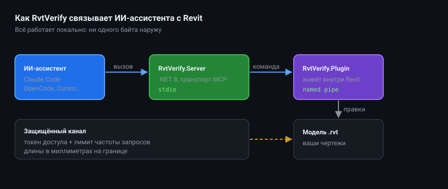
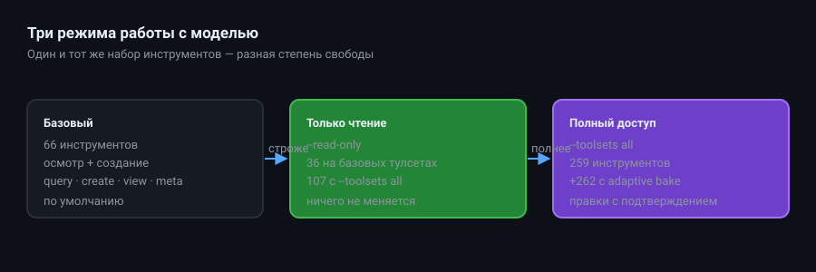
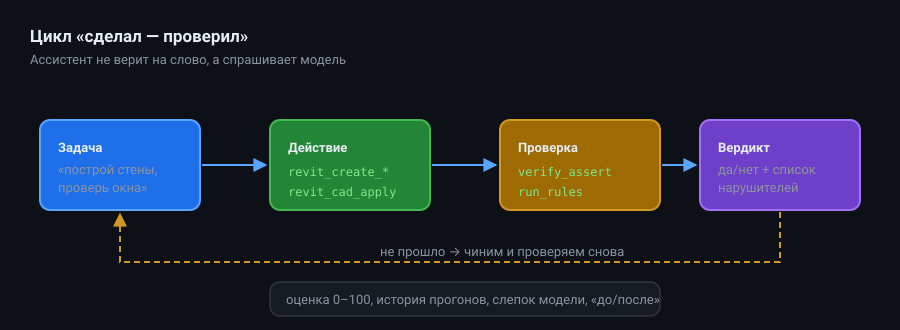
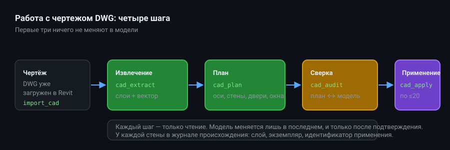
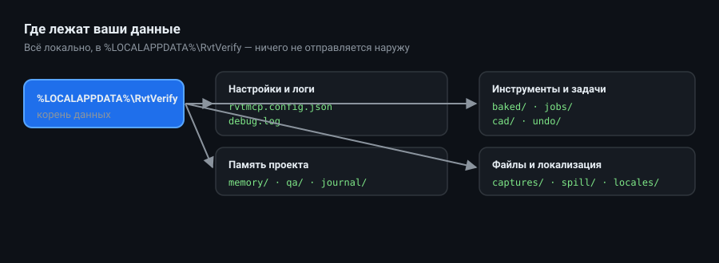

<!-- mcp-name: io.github.Daii1414/revit-verify -->

<h1 align="center">RvtVerify</h1>

<p align="center">
  <b>Мост между ИИ-агентом и вашим Revit — с проверками результата.</b>
</p>

<p align="center">
  <a href="LICENSE"></a>
  <a href="#инструменты"></a>
  <a href="#поддерживаемые-версии-revit"></a>
  <a href="https://github.com/Daii1414/revit-verify"></a>
  <a href="CHANGELOG.md"></a>
</p>

---

## Что это такое (простыми словами)

**RvtVerify** — это программа-помощник, которая связывает ИИ-помощника (Claude, OpenCode, Cursor и других) с вашим **Revit**. Вы говорите ассистенту «построй здесь стены размером столько-то» — а он через RvtVerify отдаёт команду прямо в открытый Revit на вашем компьютере.

Из чего состоит:

- **Сервер** — маленькая программа на .NET 8. Она понимает «язык MCP», на котором говорит ИИ-помощник, и запускается сама, когда помощник к ней обращается.
- **Плагин (add-in)** — устанавливается в Revit (версии 2025 и 2026). Он и есть те «руки», которые реально создают стены, окна, виды и делают снимки внутри Revit.

Сервер и плагин общаются между собой через **защищённый канал прямо внутри вашего компьютера** (named pipe).

**Ничего не уходит в интернет** — ни ваши чертежи, ни данные проекта, ни пути к файлам. Всё остаётся у вас. Это принципиально: RvtVerify — локальный инструмент.

Главное отличие от обычных «мостов» к Revit — **встроенные проверки**. Ассистент не просто «сделал стены», а сам убеждается, что они на месте, нужного размера и на правильном этаже, и показывает вам отклонения. Поэтому проект и называется **RvtVerify** (verify = проверять).

> Основа — открытый проект bimwright/rvt-mcp (Apache-2.0). RvtVerify — его развитие (форк) с дополнительными проверочными инструментами, подавлением блокирующих окон Revit и своим оформлением.

---

## Как это работает (архитектура)

<p align="center">
  
</p>

Пять важных свойств:

1. **Всё локально.** Никакого облака, никакой телеметрии. Мост живёт между двумя программами на одном компьютере.
2. **Защищённый канал.** Канал между сервером и плагином закрыт персональным токеном доступа и лимитом частоты запросов — посторонняя программа на вашем ПК не сможет командовать Revit.
3. **Миллиметры на границе.** Все инструменты принимают и возвращают длины в миллиметрах — как привычно проектировщику.
4. **Проверка вместо веры.** После любой команды ассистент может спросить «а действительно ли получилось?» и получить честный ответ со списком нарушителей.
5. **Откат без страха.** Деструктивные операции идут через схему «сначала показать, потом подтвердить», а транзакции Revit остаются откатываемыми (`revit_undo_batch` для пакетов).

---

## Установка

**Статус установщика:** установочные скрипты и релизный пакет RvtVerify ещё переносятся в этот форк. Пока плагин ставится вручную или командой сборки.

Что понадобится:

- Windows, Autodesk Revit **2025 или 2026**;
- .NET 8 (ставится сам при необходимости);
- любой MCP-клиент (Claude Code, OpenCode, Cursor и т.п.).

Сборка из исходников:

```
git clone https://github.com/Daii1414/revit-verify.git
cd revit-verify
dotnet build RvtVerify.sln
```

Собранный сервер лежит в `src/server/bin/Debug/net8.0/RvtVerify.Server.exe`, плагины — в `src/plugin-r25` и `src/plugin-r26`.

Проверить, что всё встало правильно, можно **без запуска Revit**:

```
RvtVerify.Server --doctor
```

Доктор проверит установку манифестов плагина, наличие и совпадение версий DLL, конфигурацию и доступность папки данных — и выдаст отчёт (код выхода 0/1).

### Подключение к MCP-клиенту

Пример конфигурации (файл `.mcp.json` / `mcpServers`):

```json
{
  "mcpServers": {
    "revit-verify": {
      "command": "dotnet",
      "args": ["<ПУТЬ_К_РЕПО>/src/server/bin/Debug/net8.0/RvtVerify.Server.dll"]
    }
  }
}
```

Готовые шаблоны для разных клиентов — в [docs/mcp-client-wiring.md](docs/mcp-client-wiring.md), [docs/mcp-config-claude-clients.md](docs/mcp-config-claude-clients.md), [docs/mcp-config-codex.md](docs/mcp-config-codex.md), [docs/mcp-config-opencode-kilo.md](docs/mcp-config-opencode-kilo.md), а также [.mcp.json.example](.mcp.json.example) и [opencode.json](opencode.json) в корне репозитория.

---

## Инструменты

| Режим | Инструментов | Что значит |
|-------|-------------:|------------|
| Базовый запуск | **66** | Только осмотр и создание (`query`, `create`, `view`, `meta`) |
| Все возможности (`--toolsets all`) | **259** | Полный набор |
| Все + автоподбор (`--enable-adaptive-bake`) | **262** | Добавляет 3 инструмента «предложи повторяющееся». Флаг выключен по умолчанию |
| Только чтение (`--read-only`) | **36 / 107** | С базовыми тулсетами — 36, с `--toolsets all` — 107. Ничего не меняет в проекте — можно спокойно пробовать |

Личные «запечённые» инструменты (baked tools) в это число не входят.

<p align="center">
  
</p>

### Тулсеты по темам

| Тема | Что внутри (коротко) |
|------|----------------------|
| `query` | Осмотр: вид, выделение, фильтры, статистика, параметры, связи элементов, рабочие наборы |
| `create` | Создание: оси, уровни, комнаты, линейные и точечные элементы, группы |
| `view` | Виды, листы, снимки экрана, камера, обрезка и масштаб |
| `meta` | Пакетное выполнение (`revit_batch_execute`, до 20 команд), несколько Revit, инфо проекта, очистка неиспользуемого, `send_code` |
| `lint` | Проверка именованных видов, профиль фирмы, сводка предупреждений модели |
| `schedule` | Спецификации: создание, поля, формулы, данные |
| `families` | Семейства: загрузка, типы, экземпляры, аудит |
| `modify` | Изменение: цвет, параметры, тип, копирование, поворот, **зеркало** |
| `delete` | Удаление по номеру (с предпросмотром) |
| `annotation` | Пометки, текст, размеры, ключевые заметки |
| `export` | Экспорт в PDF / DWG / IFC / NWC / DGN / DWF / FBX / gbXML, изображения, CSV спецификаций |
| `mep` | Инженерные сети: воздуховоды, трубы, лотки, короба, связность, разрывы |
| `graphics` | Фильтры вида, переопределения, видимость и фазы |
| `toolbaker` | Ваши личные «кнопки» повторяющихся действий |
| `sheets` | Листы, штампы, ревизии, раскладка видов, печать |
| `materials` | Материалы, внешний вид, назначение элементам |
| `geometry` | Габариты, замеры, коллизии, объёмы и площади, сложность геометрии |
| `rooms` | Комнаты, площади, отделка, разделители помещений |
| `links` | Связи с моделями и DWG, координаты, **чтение чертежа и план по нему** |
| `parameters` | Параметры проекта и общие параметры, привязки |
| `organization` | Сохранённые наборы выделения, шаблоны видов, **перенумерация** |
| `workflows` | Сложные сценарии «в одном вызове»: аудит модели, обзор коллизий, выгрузка данных, комплект листов |
| `structural` | Колонны, балки, фундаменты, арматура, нагрузки |

<p align="center">
  
</p>

### Что появилось именно в RvtVerify

Это то, что мы добавили сами поверх базового проекта.

**Проверки и качество (QA):**

1. **Проверка построенного** (`revit_verify_assert`) — ассистент спрашивает: «стен >= 4?», «габарит в пределах X±5 мм?», «объём плиты больше нуля?», «ребра замкнуты?», «окна реально сидят на стене и не оторваны от этажа?». В ответ — «да/нет» и список элементов-нарушителей. Понимает и русские, и английские условия.
2. **Правила проверки из файла** (`revit_verify_run_rules`) — вы один раз описываете требования YAML (например «каждый зал: 2 окна, не меньше 9 м²»), программа прогоняет всё и выдаёт оценку 0–100 с разбором по пунктам. Правила умеют привязываться к слепку модели и сверяться с ним.
3. **История оценок** (`revit_qa_trend`) — локальный журнал оценок: динамика, лучшее/худшее, разница с прошлым прогоном. Хранится только на вашем диске.
4. **Проверка опоры** — виджет `support` в assert и флаг `support_check` в пакетном вызове: элемент реально держится на хосте и не висит в воздухе (эвристика, не расчёт прочности).
5. **Показать нарушителей** (`revit_highlight_offenders`) — одним вызовом выделяет, приближает и красит «плохие» элементы; отменяется обычным Undo Revit.

**Снимки и сравнение:**

6. **Сравнение «до/после»** (`revit_capture_before_after`) — сняли кадр, поменяли, сняли снова — видно, что визуально изменилось (пиксельный diff, та же камера и размер). Свежесть базы проверяется (`max_age_hours`).
7. **Слепок модели** (`revit_capture_model_snapshot` / `revit_compare_model_snapshot`) — «фотография» состояния элементов: что добавилось, исчезло, поменялось. Версионируется и защищается SHA-256.
8. **Наборы кадров** (`revit_capture_review_set`) — до восьми именованных обзорных кадров за один вызов, с восстановлением вида.

<p align="center">
  
</p>

**Работа с чертежом DWG (полный конвейер):**

9. **Извлечение** (`revit_cad_extract`) — читает слои и векторную геометрию уже загруженного в Revit чертежа. Ничего не меняет.
10. **План по чертежу** (`revit_cad_plan`) — из точных слоёв DWG собирает упорядоченный план: оси, стены, двери и окна (дуги — двери, парные линии — окна). С привязкой к источнику (слой/экземпляр). Ничего не меняет.
11. **Сверка плана с моделью** (`revit_cad_audit`) — сравнивает хешированный план с реальными осями Revit по метке и ориентации. Ничего не меняет.
12. **Применение плана** (`revit_cad_apply`) — если план понравился, ставит стены в модель: двойная проверка «сначала показать → потом подтвердить», партиями до 20 штук (один шаг Undo) и с локальным журналом происхождения каждой стены.

**Удобство и автоматизация:**

13. **Автонумерация** дверей, окон и комнат (`revit_renumber_elements`) — номера по порядку, сверху вниз по этажам и по плану; по умолчанию только показывает, что будет.
14. **Зеркальное копирование** (`revit_transform_elements` с `op=mirror`) — отразить элементы относительно оси, с вариантом «копировать».
15. **Одно свойство по запросу** (`revit_reflect_get`) — достать ровно одно значение: имя, категорию, этаж, габарит или параметр — без `send_code`.
16. **Память проекта** (`revit_create_memory_note` / `revit_read_memory_notes`) — заметки о договорённостях проекта (единицы, именование, допуски, предположения), которые ассистент прочтёт в следующий раз. Хранится локально, максимум 200 заметок, никуда не отправляется.
17. **История изменений** (`revit_record_change`, `revit_get_change_records`, `revit_survey_change_impact`) — журнал: что, кем и когда менялось в модели, плюс оценка влияния изменения. Подробнее — [docs/change-tracking.md](docs/change-tracking.md) и [docs/change-survey.md](docs/change-survey.md).
18. **Файлы моделей** (`revit_list_recent_models`, `revit_open_model`, `revit_save_document`) — список последних файлов, открытие и сохранение модели прямо из ассистента.
19. **Точная камера** (`revit_set_view_orientation`) — точная постановка вида: точка глаза, точка цели и наклон (roll) в миллиметрах, а не только «направление + дистанция».
20. **Доктор** (`RvtVerify.Server --doctor`) — проверка установки без запуска Revit.
21. **Фоновые задания** (`revit_job`) — долгие экспорты и коллизии не блокируют ассистента: submit / status / cancel / list, ID сохраняются между перезапусками.
22. **Отчёт по работе** (`revit_distill_session`) — анализ журнала команд: что чаще всего делаете, где ошибки, длительность p50/p95.
23. **Умное поведение с окнами Revit** — при массовом построении Revit иногда спрашивает «стены пересекаются, соединить?». Программа **сама отвечает** «да», пока идёт команда, поэтому автоматизация не встаёт (вне команд окно остаётся для ручного использования). Плюс новые стены заранее соединяются геометрией (pre-join) — таких вопросов примерно вдвое меньше.

### Готовые сценарии (промпты)

Сервер отдаёт не только инструменты, но и **промпты-сценарии** — готовые инструкции для ассистента:

- `revit_getting_started` — знакомство и порядок работы;
- `revit_change` — внесение изменений в модель;
- `revit_model_audit` — аудит модели;
- `revit_pre_issue_check` — проверка перед выпуском документации;
- `revit_drawing_layout` — раскладка чертежа;
- `revit_stairs` — рабочий процесс по лестницам.

Если промпту не хватает инструментов текущей конфигурации, он честно об этом скажет, а не заставит вас угадывать.

### Снимки экрана, «печенье» и языки

- **`revit_send_code_to_revit`** — «аварийный люк»: если готового инструмента нет, можно выполнить свой код на C# прямо внутри Revit (по умолчанию включено, отключается флагом). Подробнее — [docs/send-code.md](docs/send-code.md).
- **Личные инструменты (ToolBaker)** — повторяющееся действие сохраняется как ваша собственная кнопка-инструмент; есть адаптивные подсказки. Подробнее — [docs/bake.md](docs/bake.md).
- **Лента (ribbon):** кнопки «старт/стоп», «История» (поиск и повтор прошлых команд), «Язык» — интерфейс плагина на **15 языках**, включая русский ([docs/localization.md](docs/localization.md)).

---

## Настройки

Через файл `rvtmcp.config.json` и переменные окружения. Самое полезное:

- `--toolsets all` — включить все 259 инструментов;
- `--read-only` — только смотреть, ничего не менять (удобно для первого знакомства);
- `--enable-adaptive-bake` — включить подсказки «повторить действие» (по умолчанию выключено);
- `autoJoinOverlapDialog` (по умолчанию — включено) — автоответ на окно «соединить стены»;
- `--disable-send-code` — отключить выполнение произвольного C#-кода;
- `--target` / `revit_switch_target` — выбор конкретного Revit, если запущено несколько;
- язык интерфейса плагина берётся из языка Revit, но его можно сменить кнопкой на ленте.

Подробнее — в [CLAUDE.md](CLAUDE.md), [ARCHITECTURE.md](ARCHITECTURE.md) и [docs/](docs/).

---

## Permissions & auto mode (права доступа и авторежим)

Аннотации каждого инструмента описывают, может ли он менять документ или файлы. Временное выделение, активный вид и приближение считаются чтением. `send_code` не имеет аннотаций вообще: не включайте его в автоматические разрешения и подтверждайте каждый вызов произвольного кода.

Для Claude Code копируйте **только** список read-only ниже. Не используйте широкий wildcard `mcp__revit-verify__*` — он разрешит всё, включая удаление. Список соответствует `--toolsets all`; при выбранных тулсетах инструментов будет меньше. Режим `--read-only` применяет этот же список на стороне сервера.

<details>
<summary>Список разрешённых для чтения инструментов (генерируется из аннотаций)</summary>

<!-- BEGIN READ_ONLY_ALLOWLIST -->
```json
{
  "permissions": {
    "allow": [
      "mcp__revit-verify__revit_activate_view",
      "mcp__revit-verify__revit_ai_element_filter",
      "mcp__revit-verify__revit_analyze_geometry_complexity",
      "mcp__revit-verify__revit_analyze_mep_network",
      "mcp__revit-verify__revit_analyze_model_statistics",
      "mcp__revit-verify__revit_analyze_sheet_layout",
      "mcp__revit-verify__revit_analyze_structural_connections",
      "mcp__revit-verify__revit_analyze_usage_patterns",
      "mcp__revit-verify__revit_analyze_view_naming_patterns",
      "mcp__revit-verify__revit_audit_families",
      "mcp__revit-verify__revit_cad_audit",
      "mcp__revit-verify__revit_cad_extract",
      "mcp__revit-verify__revit_cad_plan",
      "mcp__revit-verify__revit_capture_model_snapshot",
      "mcp__revit-verify__revit_check_model_health",
      "mcp__revit-verify__revit_clash_detection",
      "mcp__revit-verify__revit_compare_model_snapshot",
      "mcp__revit-verify__revit_compute_element_area",
      "mcp__revit-verify__revit_compute_element_volume",
      "mcp__revit-verify__revit_detect_firm_profile",
      "mcp__revit-verify__revit_detect_system_elements",
      "mcp__revit-verify__revit_distill_session",
      "mcp__revit-verify__revit_find_elements_in_volume",
      "mcp__revit-verify__revit_find_mep_disconnects",
      "mcp__revit-verify__revit_find_overlapping_elements",
      "mcp__revit-verify__revit_find_schedule_elements",
      "mcp__revit-verify__revit_find_undimensioned_elements",
      "mcp__revit-verify__revit_find_untagged_elements",
      "mcp__revit-verify__revit_get_assembly_members",
      "mcp__revit-verify__revit_get_available_family_types",
      "mcp__revit-verify__revit_get_change_records",
      "mcp__revit-verify__revit_get_current_target",
      "mcp__revit-verify__revit_get_current_view_info",
      "mcp__revit-verify__revit_get_element_bounding_box",
      "mcp__revit-verify__revit_get_element_centroid",
      "mcp__revit-verify__revit_get_element_details",
      "mcp__revit-verify__revit_get_element_geometry",
      "mcp__revit-verify__revit_get_element_parameters",
      "mcp__revit-verify__revit_get_element_relationships",
      "mcp__revit-verify__revit_get_family_instances",
      "mcp__revit-verify__revit_get_group_members",
      "mcp__revit-verify__revit_get_link_coordinate_system",
      "mcp__revit-verify__revit_get_link_elements",
      "mcp__revit-verify__revit_get_material_properties",
      "mcp__revit-verify__revit_get_material_quantities",
      "mcp__revit-verify__revit_get_mep_element_connectors",
      "mcp__revit-verify__revit_get_model_warnings_summary",
      "mcp__revit-verify__revit_get_panel_schedule",
      "mcp__revit-verify__revit_get_print_settings",
      "mcp__revit-verify__revit_get_project_coordinate_system",
      "mcp__revit-verify__revit_get_room_boundaries",
      "mcp__revit-verify__revit_get_room_openings",
      "mcp__revit-verify__revit_get_schedulable_fields",
      "mcp__revit-verify__revit_get_schedule_data",
      "mcp__revit-verify__revit_get_schedule_definition",
      "mcp__revit-verify__revit_get_schedule_formulas",
      "mcp__revit-verify__revit_get_selected_elements",
      "mcp__revit-verify__revit_get_structural_loads",
      "mcp__revit-verify__revit_get_system_inventory",
      "mcp__revit-verify__revit_get_titleblock_parameters",
      "mcp__revit-verify__revit_get_type_parameters",
      "mcp__revit-verify__revit_get_view_visibility",
      "mcp__revit-verify__revit_get_viewport_geometry",
      "mcp__revit-verify__revit_list_areas",
      "mcp__revit-verify__revit_list_assemblies",
      "mcp__revit-verify__revit_list_available_targets",
      "mcp__revit-verify__revit_list_baked_tools",
      "mcp__revit-verify__revit_list_export_settings",
      "mcp__revit-verify__revit_list_family_types_in_family",
      "mcp__revit-verify__revit_list_groups",
      "mcp__revit-verify__revit_list_keynotes",
      "mcp__revit-verify__revit_list_linked_cad",
      "mcp__revit-verify__revit_list_linked_models",
      "mcp__revit-verify__revit_list_loaded_families",
      "mcp__revit-verify__revit_list_materials",
      "mcp__revit-verify__revit_list_mep_systems",
      "mcp__revit-verify__revit_list_phases",
      "mcp__revit-verify__revit_list_project_parameter_bindings",
      "mcp__revit-verify__revit_list_project_parameters",
      "mcp__revit-verify__revit_list_rebar",
      "mcp__revit-verify__revit_list_recent_models",
      "mcp__revit-verify__revit_list_revisions",
      "mcp__revit-verify__revit_list_rooms",
      "mcp__revit-verify__revit_list_saved_selections",
      "mcp__revit-verify__revit_list_schedules",
      "mcp__revit-verify__revit_list_shared_parameters",
      "mcp__revit-verify__revit_list_sheets",
      "mcp__revit-verify__revit_list_titleblocks",
      "mcp__revit-verify__revit_list_view_filters",
      "mcp__revit-verify__revit_list_view_templates",
      "mcp__revit-verify__revit_list_worksets",
      "mcp__revit-verify__revit_load_selection",
      "mcp__revit-verify__revit_measure_distance_between_elements",
      "mcp__revit-verify__revit_project_point_onto_face",
      "mcp__revit-verify__revit_raycast_from_point",
      "mcp__revit-verify__revit_read_memory_notes",
      "mcp__revit-verify__revit_reflect_get",
      "mcp__revit-verify__revit_resolve_targets",
      "mcp__revit-verify__revit_select_elements",
      "mcp__revit-verify__revit_show_element_in_view",
      "mcp__revit-verify__revit_show_message",
      "mcp__revit-verify__revit_suggest_view_name_corrections",
      "mcp__revit-verify__revit_survey_change_impact",
      "mcp__revit-verify__revit_verify_assert",
      "mcp__revit-verify__revit_verify_run_rules",
      "mcp__revit-verify__revit_workflow_model_audit"
    ]
  }
}
```
<!-- END READ_ONLY_ALLOWLIST -->

</details>

---

## Безопасность и приватность

- Всё работает **локально**. Ни чертежи, ни данные проекта, ни пути к файлам не уходят в интернет.
- Канал между сервером и плагином закрыт **токеном доступа** (создаётся при запуске, хранится только у вас) и лимитом частоты запросов.
- Инструмент `send_code_to_revit` умеет выполнять произвольный код — если он вам не нужен, отключите (`--disable-send-code`).
- Деструктивные операции идут через схему «сначала показать, потом подтвердить».
- Крупные ответы не рвут сессию: они выгружаются в локальные файлы (spill) и живут ограниченное время.
- Журнал работы ведётся локально и может быть выключен.

<p align="center">
  
</p>

Подробности — в [SECURITY.md](SECURITY.md).

---

## Поддерживаемые версии Revit

| Версия Revit | Плагин |
|--------------|--------|
| 2025 | ✅ `RvtVerify.Plugin` (2025) |
| 2026 | ✅ `RvtVerify.Plugin` (2026) |
| 2022–2024, 2027 | Пока нет (в базовом проекте сломаны / требуют другого .NET). Вернёмся позже. |

Если запущено **несколько Revit сразу** — программа сама разберётся, какой из них брать: `revit_list_available_targets` покажет все экземпляры, `revit_switch_target` переключит. Команды никогда не уйдут в «чужой» Revit.

---

## Статус проекта

Проект находится в активной разработке. Уже сделано и проверено вживую на реальных моделях:

- ✅ 259 инструментов; в режиме `--read-only` остаётся 107 (36 — на базовых тулсетах);
- ✅ проверки результата (assert, YAML-правила, история оценок, слепки модели, сравнение «до/после»);
- ✅ полный конвейер работы с чертежом DWG: извлечение → план → сверка → применение с подтверждением;
- ✅ автоответ на блокирующие окна Revit + предварительное соединение стен;
- ✅ фоновые задания, доктор установки, отчёты по сессии;
- ⏳ установщик (переносится из базового проекта).

Что нового — смотрите в [CHANGELOG.md](CHANGELOG.md).

---

## Развитие проекта

- [CONTRIBUTING.md](CONTRIBUTING.md) — как вносить изменения.
- [CODE_OF_CONDUCT.md](CODE_OF_CONDUCT.md) — правила сообщества.
- Тесты: `dotnet test RvtVerify.sln` (каталог `tests/`).

---

## Лицензия и авторы

- Основа: **bimwright/rvt-mcp**, автор Khoa Le, лицензия **Apache-2.0**.
- Развитие и проверочный слой: **Daii1414** (RvtVerify), тоже **Apache-2.0**.
- Берёте куски кода — сохраняйте уведомление об авторах и лицензию.

---

## Ссылки

- [Репозиторий](https://github.com/Daii1414/revit-verify) — исходники на GitHub.
- [CHANGELOG.md](CHANGELOG.md) — что нового.
- [CLAUDE.md](CLAUDE.md) — как устроено внутри (для разработчиков и ассистентов).
- [ARCHITECTURE.md](ARCHITECTURE.md) — архитектура подробно.
- [docs/](docs/) — инструкции: [установка](docs/install.md), [подключение клиентов](docs/mcp-client-wiring.md), [чертежи DWG](docs/cad-planning.md), [лестницы](docs/stairs-workflow.md), [send_code](docs/send-code.md), [ToolBaker](docs/bake.md), [локализация](docs/localization.md), [отслеживание изменений](docs/change-tracking.md), [анализ влияния изменений](docs/change-survey.md), [профили фирмы](docs/firm-profiles/README.md), [контракты размещения и MEP](docs/placement-and-mep-contracts.md).
